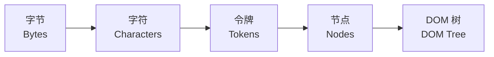

## 1.手撕

一道比较版本号的题，就是纯字符串解析，最后大概7-8min做出来了，描述空间复杂度与时间复杂度也没什么问题

但是可能没做好的地方就是使用了中转`vector`来存储数字，面试官指出可以通过边处理边比较的方式省掉这个空间复杂度

---

## 2.八股

### 2.1.从输入URL到页面渲染都发生了什么

这里只说出来DNS解析和路由器，今天重新理一遍

#### 2.1.1.URL解析与缓存检查

首先是第一阶段，URL解析与缓存检查

浏览器先对输入的内容进行解析，检查输入的内容是网址还是搜索词，并自动补全协议和端口

然后检查浏览器的本地缓存，这里有两种情况

- 先看浏览器自身有没有强缓存，如果没有过期，直接取缓存跳到渲染阶段
- 如果缓存失效，尝试进行协商缓存，发送请求到服务器询问文件有没有修改过，如果没改就是304，继续使用缓存

---

#### 2.1.2.DNS解析

如果本地完全没有缓存，就开始查IP，这一步也就是DNS解析

1. 依次查询浏览器缓存、系统缓存、路由器缓存
2. 如果本地找不到，尝试向ISP(运营商)DNS服务器发起递归查询
3. 运营商DNS通过根域名服务器到顶级域服务器再到权威域名服务器进行层层查询，最终拿到目标的IP地址

对于其中第三步，根域名服务器本身并不会直接告诉你最终的IP地址，而是通过查看你请求的后缀，例如`.cn`, `.com`，然后把负责管理这个顶级域的顶级域名服务器(TLD Server)的地址告诉你

然后顶级域名服务器也不会直接告诉你IP地址，它是负责管理特定顶级域名下的所有二级域名注册信息的，在收到请求之后，会根据网址判断管辖这个域名的权威解析服务器是哪个，然后把对应的权威域名服务器地址返回给你

最后权威域名服务器根据网址，返回精确的IP地址

---

#### 2.1.3.网络连接

拿到IP地址之后，就尝试建立网络连接，也就是TCP三次握手与TLS/SSL握手，这里也简单过一下

##### 2.1.3.1.TCP三次握手

1. **第一次握手**：客户端发送一个带有`SYN`同步标志位的报文，并随机选择一个初始序列号 $x$，此时客户端进入`SYN_SENT`状态
2. **第二次握手**：服务器收到`SYN`报文之后，回传一个确认报文，该报文将`SYN`和`ACK`标志位同时设为`1`，确认号填入 $x + 1$，并自己随机产生一个随机序列号 $y$，此时服务端进入`SYN_RCVD`状态
3. **第三次握手**：客户端收到服务端的确认之后，给服务端发送一个`ACK`确认报文，确认号填入 $y + 1$，序列号为 $x + 1$，服务端接收之后，双方进入`ESTABLISHED`状态

---

##### 2.1.3.2.TLS握手

这里以现代主流的TLS 1.3为例

1. 首先是客户端向服务器发送它支持的TLS版本和支持的密码套件，以及一个随机数和密钥交换参数
2. 服务器挑选一个双方都支持的TLS版本和密码套件；发送自己的随机数、数字证书以及服务端的密钥交换参数；并在服务器端计算出会话密钥
3. 客户端收到服务器的证书，验证其合法性；验证通过后，客户端使用服务器发送的参数和自己的参数，在本地计算出会话密钥
4. 双方互发一条加密的`Finished`信息，测试加解密是否通过，验证成功，握手结束

---

#### 2.1.4.HTTP请求与响应

1. 浏览器组装HTTP请求报文，包括Cookie、请求头等，通过建立好的TCP链路发送出去
2. 服务器收到请求，进行后端处理，返回HTTP响应

---

### 2.2.收到HTML到渲染出网页的流程

首先是HTML的解析以及DOM树的构建

如果画成结构图就大概是这样：

浏览器从服务器获取的只是一堆字节，它需要先通过编码将字节转为字符，再通过**词法分析**切成各种令牌比如`<html>`, `<body>`，接着把令牌变成对应的节点对象，最后再拼成一棵DOM树

与HTML类似，接下来是CSS解析以及CSSDOM树构建，浏览器看到`<link>`或者`<style>`标签里的CSS时，也会把样式文件解析成CSSDOM树

随后是构建渲染树，DOM树+CSSDOM树=渲染树，浏览器将两棵树结合起来，需要注意的是渲染树只包含可见节点

接着是布局，现在渲染树已经构建完成，但是它还不知道每个元素在屏幕上的绝对精确位置和大小

布局阶段就是浏览器从根节点开始递归计算，确定每个元素在视口中的确切坐标以及尺寸

最后则是绘制阶段了，这一步会遍历渲染树，把每个节点转换成屏幕上的实际像素，如果是复杂的页面，还会分成多个图层分别绘制，最后合成展示

然后JavaScript脚本是如何参与渲染的呢？当HTML切令牌的时候，遇到一个`<script>`标签，会立刻暂停HTML的解析，并转而去下载并执行JavaScript，因为JS可能随时会通过`document.write`修改DOM结构，HTML解析器需要停下来等它运行完

这也是为什么`<script>`标签通常放在底部或者加`async`, `defer`，就是为了防止JS把页面卡成一片空白

---

## 3.项目

这里问了我的HardSeat-Hero，大概讲了一下算法优化，然后比较可惜的是说了性能瓶颈在于网络I/O所以我考虑将在线搜索转为离线搜索之后，面试官问我是不是还停留在设想阶段，我考虑到当前确实没有收尾执行，就答了是

后面反应过来，我其实已经做好了离线搜索引擎以及云函数爬取逻辑，至少应该把这个说出来

---

## 4.Agent开发

这里面试官先问了我在日常开发中使用Agent如何提升它的准确性

这边我答了TDD测试驱动开发

然后面试官又问有没有其他策略提升效率

然后有点卡壳，因为平时确实没有怎么考虑效率问题，于是阐述了自己平时主要是确保正确性，从文档设计到切片开发再到验证和日志记录讲了一遍

其实这边应该自信一点，回头看有很多磕磕绊绊显得不自信的地方

比如可以说在Agent开发中，确保正确性本身就是最高效的策略，因为可以避免幻觉和错误累积造成的后续大量时间用于返工

具体到落地，通过三个层面兼顾效率和质量

1. 架构与上下文对齐，先给Agent喂明确的业务状态机和状态流程图，输出结构化的执行计划，把一个大的任务或者需求拆成细粒度的切片，避免一次性生成太多代码导致失控
2. TDD验收门禁，让Agent根据边界条件和业务逻辑生成测试用例，测试不通过代码不合入
3. 工具链提效，在日常开发中，通过结合容器化和自动化脚本，把测试和lint校验集成到流水线中，通过规范化的Agent Runtime来减少重复的手动干预

---

## 5.MCP Server, Skill, Rule

这一部分基本答上来了，但是可能语言组织不够规范

面试官首先问了有没有使用一些skill或者MCP之类的

这里我提到我日常使用Cline进行开发，然后注意到它直接使用原生命令进行操作，认为不够安全，就通过在本地注册一个MCP Server，在其中绑定了一些类似`list_files`, `apply_patch`这样的工具

以及开发了一个能够通过Workbench远程操控ECS的skill

然后介绍了一下将学长的OpenMeta项目进行二次封装，在本地注册对应的MCP，并绑定对应工具以更好地参加GitHub开源

接着面试官问了一下Rule和Skill的区别，这里差不多答到点子了，但是有点乱，整理一下

- Rule：定义的是边界与规范，是全局或者项目级的约束，例如每次修改必须在独立Worktree，必须写开发日志，解决的是不能踩什么坑
- Skill：定义的是方法与流程，它是一个可复用的工作流或者领域知识，例如如何规范地重构一个组件，解决的是如何将一件复杂的事情做好

---

## 6.登录

面试官问了我有没有了解过登录相关的东西，这方面确实没怎么接触过，只说了一个Cookie，然后提了一下JWT，但是也不了解背后的机制

OK，今天就来详细了解一下

---

### 6.1.传统Cookie+Session机制

大概流程就是

1. 用户在前端输入账号密码发送给后端
2. 后端验证成功后，再服务端或者Redis内生成一个Session，比如记录`user_id = 123`，并把这个Session的ID，比如`session_id = abcxyz`通过响应头`Set-Cookie`发给浏览器
3. 浏览器会自动把这个Cookie保存下来
4. 以后每次发请求，浏览器都会自动在这个请求头里带上这个Cookie
5. 后端拿到Cookie后，去内存或者Redis内查一下这个ID还在不在，有没有过期

后端在存储Session时会设置一个绝对过期时间或滑动过期时间

时间到了，后端直接把这个Session删掉，或者检查发现它过期了，就拒绝请求，要求重新登录

---

### 6.2.JWT(JSON Web Token)机制

这个是无状态模式，现代主流

为什么不用Session了呢？如果后端做了集群，用户第二次请求被分发到另一台服务器上，另一台服务器没有存这个Session，用户就被迫重新登录了，或者需要搞Redis共享Session，也就是状态在分布式系统中的一致性问题，而JWT解决了这个问题

核心原理大致如下：

1. 登录成功后，后端根据用户信息加上一个密钥，通过特定的算法比如HS256，在服务端算出一个加密字符串，这个就是JWT
2. 后端把这个JWT返回给前端
3. 前端通常把它存在`localStorage`、`sessionStorage`里，以后每次把它放在请求头中
4. 后端不需要查数据库或者Redis，直接用同样的密钥去解密这个Token，只要签名合法且`exp`过期时间没过，说明用户合法

有一个缺点是因为它是无状态的，Token一旦签发，服务端无法在过期之前主动作废，除非引入黑名单机制

所以一般JWT的过期时间会设得比较短，同时配合Refresh Token刷新令牌使用
