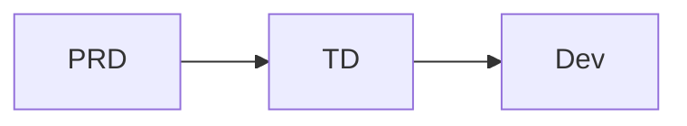
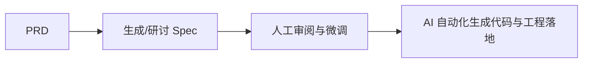

# Shopee入职一周随感

## 1.绪言

一转眼已经入职Shopee一周了，真的学到了特别多的东西，然后今天也就是周五先是跟mt开了早会聊了一些问题，后面下午去参加了新人入职培训，颇有启发，故作此篇

---

## 2.架构选型的本质

首先我们团队是做类似于面向公司内部开发和管理审批的中台业务，大概有两个系统，我这周读了一下源码实现，理解了一下大致的逻辑，发现了一个比较有意思的设计：有一个系统最初曾计划使用Kafka作为消息队列处理，然后也确实在一层链路上做了实现，然而在如今的最终使用的生产实现中，Kafka被当做了一个回退降级兜底选择，团队使用了纯HTTP通信，然后并发控制也直接交给数据库处理

然后我把Kafka链路实现中的几个问题记了下来，早会上和mt讲了，然后他就跟我讨论了一下当时具体为什么要这么做

首先是Kafka通信的问题，我们是中台嘛，面向企业内部，在这个基础设施环境中，SRE经常需要调整代理与网络配置，Kafka如果需要跨代理通信，需要配置和维护复杂的TCP连接与协议转换；但是如果直接用HTTP就简单，对域名解析和网关代理友好，维护成本比较低

Kafka的优点在于什么呢？我们知道它是一个分布式的**发布-订阅**消息系统，通过队列实现削峰填谷，异步处理任务，在性能上具有强悍的优势，但是现在的场景显然不需要这种优势，内部使用并发数甚至不过百，你用什么东西都可以

其次是关于为什么要用数据库扛并发，其实上面也已经说过了，同一个原因，没有必要，在这个情况下盲目地引入Redis或者其他消息队列，你还得用额外的容器维护，也提升了系统故障时的排查难度

换句话说，这就是典型的边际收益极小场景，用复杂数倍的实现与维护来换不值当

---

## 3.从PRD到Spec驱动开发

然后mt讲到一个现在业务在普遍推进采用的点就是Spec驱动开发

传统的开发流程像这样：

由甲方描述需求，PM做PRD，然后开发组做TD，最后整体投入开发

但是现在趋势是变成这样：

就相当于拿着PRD，你去生成一个Spec，进行微调之后直接跑出来项目和需求，后续需要更新的时候就更新Spec就可以，AI再根据Codebase差异进行增量变更

为什么要采取这样的工作模式呢？如果仔细品味就会发现，这实际上是一种代码资产的深度提炼与蒸馏，团队的工程规范，最佳实践，之前遇到的问题和踩坑记录，都被固化在Spec中

从一定意义上来说，它降低了个人的不可替代性，你个人的思考和智慧是自己的资产，但是Spec是公司的资产，让原本存在的那些一个人掌握团队核心技术的场景弱化了，我有你这个Spec，只要证明这种工作方式是有效的，那我随便拉一个人过来，招应届生上来接手一下就能做

这是一种倒逼，我们现在研究的工作模式最后会淘汰我们自己（

但是这种趋势的出现也已经无可避免，所以了解并适应，相信车到山前必有路^^

---

## 4.重新审视AI提效：没有银弹

接下来是新人培训讲座，讲师在QA环节也聊到了业界对AI降本增效的感触

描述是大概今年年初，称作AI的大跃进时期，整个行业一片恐慌，大家都说AI提效了十几倍甚至几十倍，岗位会大规模缩水，像测开这种岗位，与开发的比例要逐渐降低，到一比十再到一比二十

但是事实上现在已经到年尾，我这个测开实习生刚被招进来几天，测开还是在正常招，我团队里的同事还是在正常上班

AI的确带来了提效，但是绝对没有几倍几十倍这么夸张，大概只有30%左右，这个数字没有到让所有人都失业的地步，而且AI也的确带来了很多新岗位

虽然知道这可能也只是管理层为了安抚员工的说辞，但是我确实认为在一定程度上没有说错，就像软件工程领域的那句老话：

> No sliver bullet.

没有银弹，AI也不会是银弹，至少现在不是

我们还是需要人来担责，跟你说效率提升几十倍，但是AI写出来的代码它又担不了责任，所以得你来，你会愿意吗？根本就review不过来，这是心里没有底

另外，复杂度仍然是不可消除的，软件工程的根本难点在于抽象、逻辑一致性以及对模糊需求的确定化，这些复杂性不会因为AI的存在而凭空消失

对于我们这些技术开发者来说，这或许是一种利好：它的价值在于打破了技术领域之间的壁垒，降低了探索新领域的门槛，能够让你用很低的成本去了解，去尝试，去做

---

### 5.小结

总而言之，保持对前沿技术的敏感，保持对业务场景的理解，保持一颗充满热忱的好奇心
